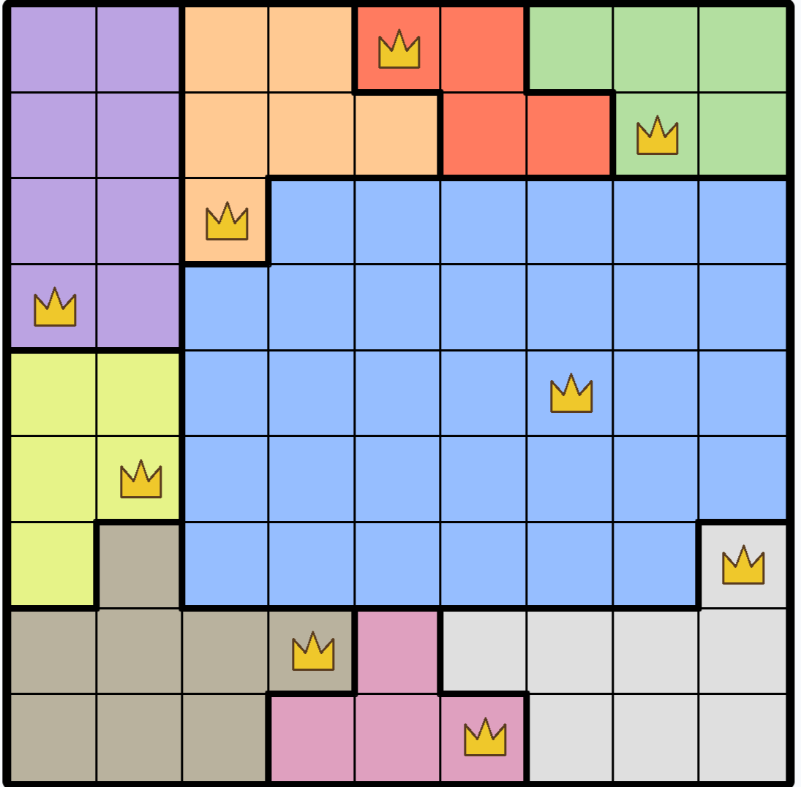
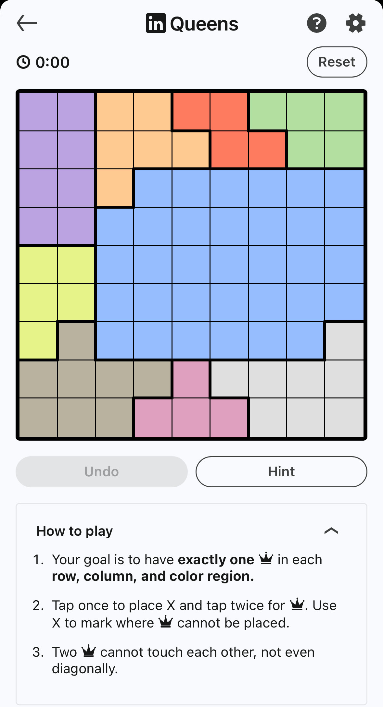
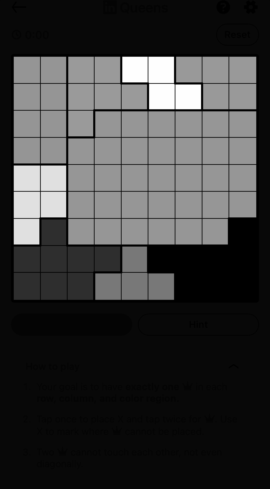
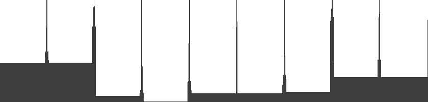

# Queens Puzzle Solver

Solves [LinkedIn's daily Queens puzzle](https://www.linkedin.com/games/queens/) from a screenshot: finds the board, reads the color regions, solves the puzzle with constraint programming, and draws the solution back onto the original image.

<!-- IMAGE: overlay result — a solved board with crowns drawn on. This is the
     money shot; put it here, full width, nothing above it but the title. -->


**[Live demo](https://queens-solver-daly.onrender.com/)** — hosted on a free tier, so the first load takes about a minute to wake the server.

---

## The puzzle

An N×N grid divided into exactly N colored regions. Place one queen in every row, every column, and every colored region, and no two queens may touch — including diagonally. Every valid puzzle has exactly one solution.

<!-- IMAGE: an unsolved board next to its solution, or a single annotated board
     showing the rules. Small, side by side if you can. -->



## The interesting half is the vision

The constraint model is about 20 lines. Recovering the puzzle from a screenshot is the rest of the project.

### 1. Find the board

The board is the only large saturated object in the screenshot, so it's isolated by **chroma** — distance from neutral in Lab color space — rather than by brightness or hue. A morphological close merges the individual cells into one blob, and the largest contour's bounding rectangle gives the corners.

A fill-ratio check rejects the result if the blob doesn't roughly fill its bounding box, which catches the case where surrounding UI gets merged into the board.

<!-- IMAGE: the chroma mask, white board blob on black. Readers find this one
     surprisingly satisfying. -->


### 2. Warp to a canonical square

A perspective transform maps those four corners to a fixed-size square. Every later stage works in warped space, where cell boundaries are at predictable coordinates and the geometry is trivial — the homography is kept so the solution can be projected back afterward.

<!-- IMAGE: the warped board. Optional — include only if it reads clearly
     next to the original. -->

### 3. Infer the board size

Board size isn't known in advance. The warped board is converted to a darkness profile along each axis; interior gridlines show up as spikes above the floor of region-color variation. Counting runs above a threshold gives the number of interior lines, and therefore N.

Both axes must agree. Disagreement means the grid was misread, and the scan fails rather than guessing.

<!-- IMAGE: the darkness profile plot with the threshold line drawn across it.
     This one explains itself better than any paragraph can. -->


### 4. Recover the regions

Each cell's color is sampled from a patch at its center, clear of the gridlines, using the median to resist antialiasing. Those colors are converted to Lab and clustered with k-means at k = N.

Setting k = N is a hypothesis, not a fact: it asserts that the number of color regions equals the board size. The puzzle's rules guarantee it, but a misread board can violate it, which is caught downstream.

### 5. Solve and project back

The region matrix becomes a `Puzzle`, which validates on construction — shape, region completeness, and BFS contiguity of each region. An invalid puzzle can't be constructed, so every `Puzzle` downstream is known good.

The solver (CPMpy over CP-SAT) places one queen per row, column, and region with no two adjacent, then adds a blocking clause excluding that solution and solves again. A second solution means the scan was wrong, since real puzzles are unique.

The inverse homography maps cell centers back to original-image coordinates, and the crowns are drawn there — so the overlay lands on the user's screenshot, not on the warped square.

## Architecture

```
image → scan → solve → overlay
```

```
src/
├── solver/      # Puzzle data model, CP model, uniqueness check
├── vision/      # Screenshot → region matrix
├── pipeline/    # Composition + cross-cutting failure policy
└── web/         # FastAPI adapter + static frontend
```

Dependency arrows point one way: nothing imports `web`. The pipeline layer owns composition and failure policy; the web layer is a thin HTTP adapter with no logic in it. pytest, the debug harness, and uvicorn are interchangeable callers of the same functions.

### Expected failures are data; unexpected failures are bugs

The pipeline catches exactly two exceptions — a failed scan and an invalid puzzle — and maps non-unique solver results to their own statuses. Everything else propagates. Catching broadly would disguise real defects as ordinary scan failures and throw away the traceback at the moment it was created.

Each failure mode gets its own message, since they call for different fixes from the user: a bad scan means retake the screenshot, a non-unique solution means a cell was misread.

Results carry a coherence invariant, enforced at construction: success implies both an image and a solution are present, and any failure implies neither is. An incoherent result raises immediately at the construction site rather than surfacing as a confusing `None` somewhere downstream.


## Tests

Fixture screenshots paired with hand-typed region matrices; the scan is verified against known solutions. Grid inference is unit-tested with synthetic profiles. Pipeline success is verified by asserting the solution's properties — one queen per row, column, and region, none adjacent — rather than by comparing to a stored answer.

Solved or partially solved boards are deliberately excluded as fixtures for the color pipeline, since pre-placed queens change the cell colors being clustered.

## Running it

```bash
pip install -e ".[dev]"
uvicorn web.app:app --reload     # http://localhost:8000
pytest
```

Deployed on Render's free tier. The app is stateless, so spinning down costs nothing but the wake-up.

## Roadmap

**Live camera mode** — pointing a webcam at a phone screen, with frames streamed over a WebSocket and a lock triggered when the region matrix is stable across consecutive frames and yields a unique solution. This breaks most of the assumptions above: rotation, lighting, and glare all land directly on the documented fragilities.

**Tango** — the repo is a monorepo because Queens was never meant to be the only solver. Tango's constraints are simpler, but its board detection needs a different approach: the grid has no color regions to find, and its constraint symbols sit on cell boundaries rather than in cells.